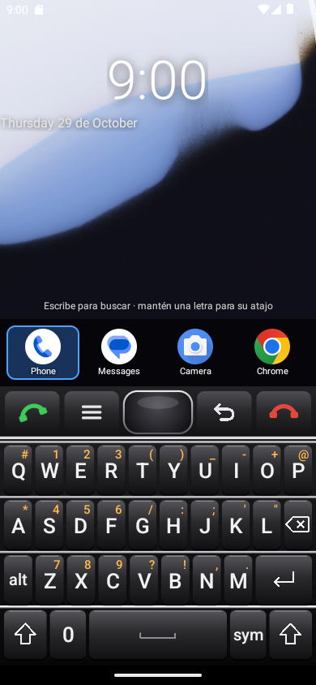
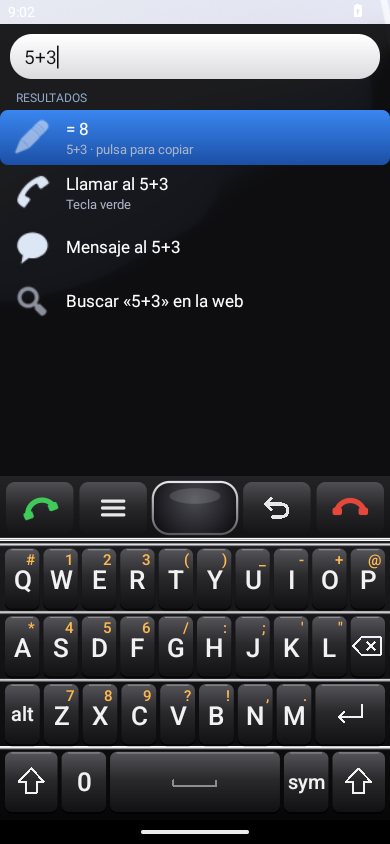
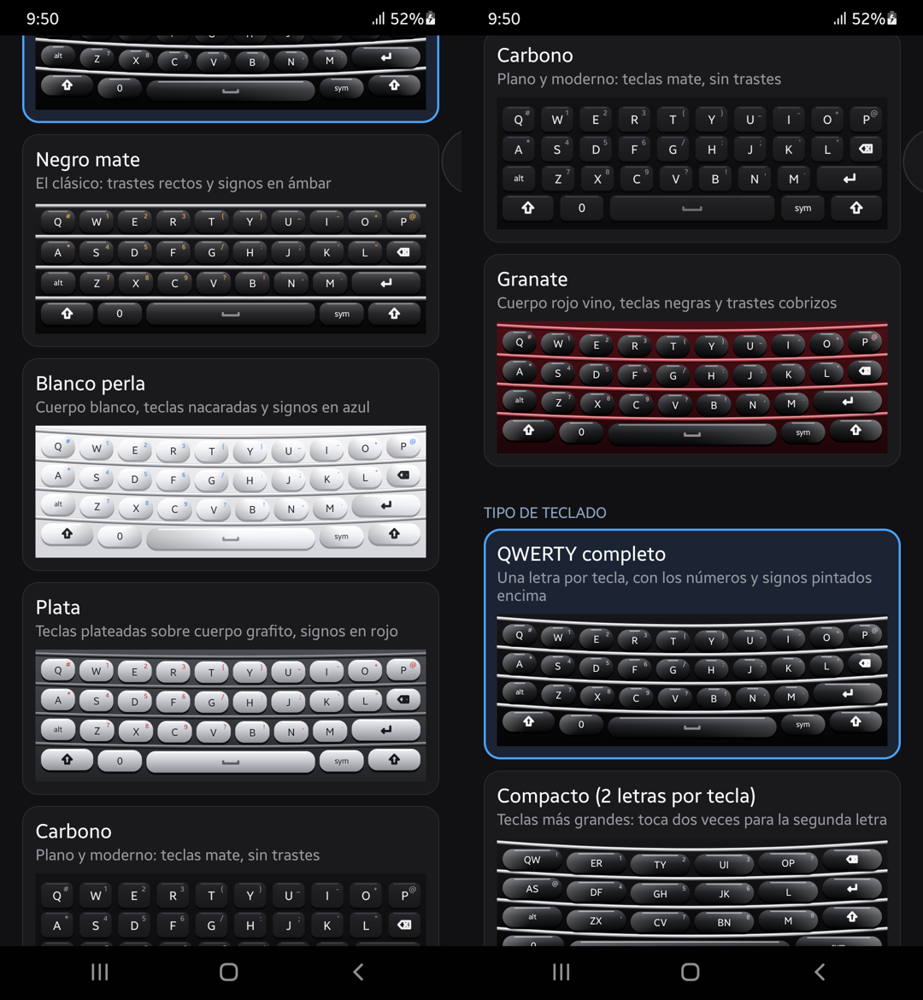
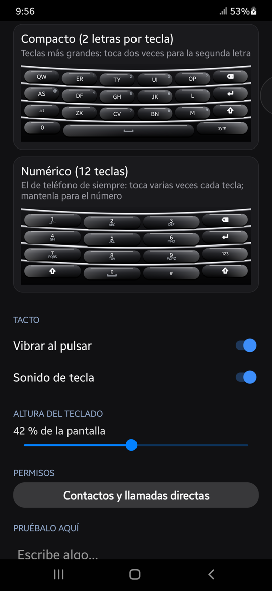

# Teclas

Launcher y teclado para Android que convierten un celular táctil en un teléfono con teclado QWERTY clásico: pantalla arriba, fila de navegación con trackpad y teclado de cuatro filas abajo.

<p align="center">
  
  
</p>

## Características

- **Teclado dibujado a mano** (Canvas, sin AndroidX ni Compose): QWERTY con números y signos sobre cada tecla, `alt` / `shift` / `sym` (un toque = una vez, dos = bloqueado), mantener = mayúscula, multitáctil y borrado con repetición.
- **Fila de navegación**: llamar, menú, trackpad (deslizar = flechas, tocar = clic), atrás y colgar.
- **Launcher**: reloj, apps fijadas y búsqueda universal con solo empezar a escribir (apps, contactos, ajustes, linterna, cuentas tipo `5+3`, números de teléfono leídos de las teclas y búsqueda web). Mantener una letra abre su atajo.
- **Teclado del sistema (IME)**: el mismo teclado en cualquier app, con mayúscula automática y doble espacio = `. `.
- **Teclado fijo** (servicio de accesibilidad, opcional): deja el teclado siempre visible en todas las apps y permite navegar la interfaz con el trackpad.
- **Modo dividido** (experimental): la app arriba y el teclado abajo en pantalla dividida.
- **Seis pieles** (negro brillante, mate, perla, plata, carbono y granate) y **tres distribuciones**: QWERTY, compacto (2 letras por tecla) y numérico de 12 teclas.
- **Español** por defecto: Ñ junto a la L y acentos con `sym` + vocal.
- **Interruptor general** en Ajustes y en los ajustes rápidos para volver al launcher y teclado anteriores.

<p align="center">
  
  
</p>

## Requisitos

| | |
|---|---|
| Android | 10 o superior (`minSdk 29`, `targetSdk 34`, `compileSdk 35`) |
| JDK | 17 |
| Build | Gradle 8.13 (incluido con el wrapper), Android Gradle Plugin 8.10.1, Kotlin 2.1.0 |
| Android SDK | Platform 35 |

## Compilar

Crea `local.properties` con la ruta de tu Android SDK (o define `ANDROID_HOME`):

```properties
sdk.dir=/ruta/a/Android/Sdk
```

Luego, con `JAVA_HOME` apuntando a un JDK 17:

```bash
./gradlew assembleDebug          # Windows: gradlew.bat assembleDebug
```

El APK queda en `app/build/outputs/apk/debug/app-debug.apk`.

## Instalar

```bash
adb install -r app/build/outputs/apk/debug/app-debug.apk
```

En el teléfono, abre **Teclas · Ajustes** y sigue los tres pasos de puesta en marcha (teclado del sistema, launcher y teclado fijo opcional).

Para volver al teclado y al launcher anteriores basta con el interruptor de Ajustes, o por ADB:

```bash
adb shell ime reset
adb shell cmd role add-role-holder android.app.role.HOME <paquete.del.launcher.anterior>
```

## Permisos

- **Contactos y llamadas**: para buscar contactos y llamar con la tecla verde.
- **Consultar apps instaladas**: necesario para funcionar como launcher.
- **Accesibilidad** (opcional, solo el teclado fijo): lee la pantalla únicamente para saber cuándo esconderse y para escribir en el campo de texto. No guarda ni envía nada.

## Licencia

[MIT](LICENSE) © 2026 Jorshua Jiménez
